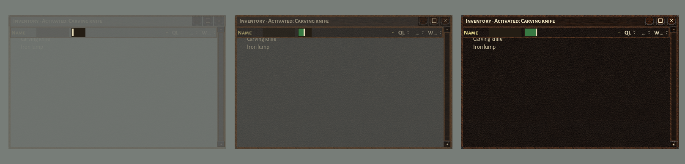
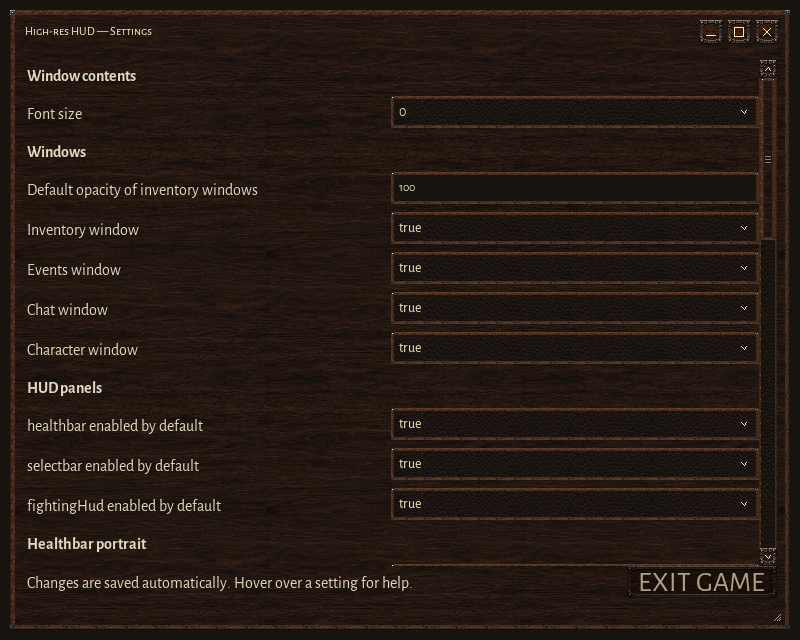

# High-res HUD for Wurm Unlimited


[](https://github.com/chamomilo/Wurm-HighRes-HUD/releases/latest)
[](LICENSE)

Readable inventory windows, detailed portraits and a consistent walnut-and-leather
interface for Wurm Unlimited. One client mod includes the Healthbar, Select bar,
Fighting HUD, Character, Inventory, containers, Chat and Events.

**Version 0.7.5** includes Chamomilo updater **1.5.0**, its shared **Settings**
editor and Chamomilo UI **0.4.11**. English, Brazilian Portuguese, German and
Russian are supported. No server mod is required.

**[Download the installable ZIP](https://github.com/chamomilo/Wurm-HighRes-HUD/releases/latest)**

## Install or update

Requires Wurm Unlimited and
[Ago's Client Mod Launcher](https://github.com/ago1024/WurmClientModLauncher),
using the client's Java 8 runtime.

1. Close the game and download `highres-hud-0.7.5.zip`.
2. Extract it into your `WurmLauncher` directory, merging the `mods` folder.
3. Disable any old standalone `highres-healthbar`, `highres-selectbar` or
   `highres-fighting-hud` mods; their panels are included here.
4. Start the game through Client Mod Launcher.

The ZIP contains exactly these five files:

```text
README.txt
mods/highres-hud.properties
mods/highres-hud/highres-hud-0.7.5.jar
mods/highres-hud/highres-hud-resources-0.7.5.jar
mods/highres-hud/portrait-profiles.bundled.properties
```

Keep the bundled portrait profiles alongside the JARs. Images in this guide,
source code, build tools and development files are excluded from the installable
ZIP. Installation and updates are manual.

## Inventory and containers

Type in **Filter**, beside the **Name** heading, to find loaded items and matching
nested contents. The filter clears when the window closes. Click a column heading
to sort; later item updates retain your chosen manual order.

When dragging an item:

- Hold over a collapsed group or container for **one second** to expand it.
- Release in another item window **before one second** to move to that inventory
  and put the item at the end of its list.
- After **one second** in that window, use **Insert here** to choose a position
  between rows, or **Put inside** to choose a particular container.

The chosen position survives the server response, including multiple selected
items and positions inside a group. Leaving the target window resets its delay;
leaving a collapsed group resets its expansion delay. Wurm's container and
capacity restrictions still apply.

The slider to the right of Filter changes that window's opacity from **10% to
100%**. Drag the vertical marker; the area to its left fills green. Text and frame
fade together, while the slider stays visible. In 0.7.5 its field and mouse area
are 30% wider than in 0.7.4.



Set **Default opacity of inventory windows** in Settings to choose the value used
whenever an inventory or container window opens. Changing the default leaves
already-open windows at their individual values.

## Settings, language and updates

Open **Main menu > Mod updates**, find **High-res HUD**, and click **Settings**.
Valid edits save automatically. Hover over an option for its explanation.



| Option | Effect |
| --- | --- |
| Font size | Changes inventory rows, chat, events and other window contents immediately; `0` follows the native preference. |
| Default opacity of inventory windows | Initial opacity for newly opened item windows: 10–100%, initially 100%. |
| Inventory / Events / Chat / Character window | Enables each window's skin at the next client start. |
| HUD panel defaults | Controls initial panel visibility for a new HUD profile. |
| Portrait and combat options | Adjusts portraits, animations and combat observation storage. |

Startup-only changes show a restart notice. **Exit game** saves valid edits and
opens Wurm's standard quit confirmation. See the [settings guide](docs/SETTINGS.md)
for more detail.

The same Mod updates window selects the shared language for installed Chamomilo
mods and checks available releases. Its Download button opens the release page.
The newest compatible embedded updater is selected among installed mods.

## Character

The default view shows your full-body 3D model. Drag to rotate; click changes its
pose. Switch to **Body zones** to inspect wounds and use native item actions.
Healthy anatomy is ivory; wound severity progresses through green, yellow,
orange and red. Empty equipment slots use muted artwork.


Corner controls show carried weight and limits, provide body and Manage actions,
and select hands as the active tool. **Unequip all** uses Wurm's native action.

## Healthbar, selection and combat

The Healthbar shows your portrait, gauges, effects, fatigue, speed and ride
information, with Sleep bonus and Disembark controls. The Select bar adds target
portraits, status, action progress and paged quick actions. The Fighting HUD
combines target health, attack zones, Combat focus, special moves and optional
learned combat statistics.


| Control | Action |
| --- | --- |
| Healthbar portrait | Click changes pose; wheel zooms; right-click opens display options. |
| Select portrait | Drag rotates; wheel zooms; right-click opens native target actions. |
| Select action shelf | Click the page indicator or use the wheel to change action pages. |
| Select Pin | Keeps selection visible after the pointer leaves. |
| Fighting portrait | Drag rotates; wheel zooms; double-click clears the target. |

## Chat and Events

Commands, history, text editing and clipboard support remain native. Additional
channel rows grow above the primary row. Right-click **Skills** to choose the
smallest skill tick displayed.


Images are rendered interface previews. The running client supplies actual
portraits and game data.

## Configuration and license

Settings overrides are stored in your user profile. You can also edit
`mods/highres-hud.properties` while the game is closed. Optional custom portrait
profiles belong in `mods/highres-hud/portrait-profiles.properties`; the bundled
reference remains separate. Combat observations default to
`mods/highres-hud/knowledge`.

Distributed under the [GNU General Public License v3](LICENSE). The runtime JAR
contains `META-INF/LICENSE.txt`; bundled fonts retain their own license notices.

Developers can find the [build instructions](docs/BUILDING.md) separately.
