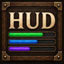
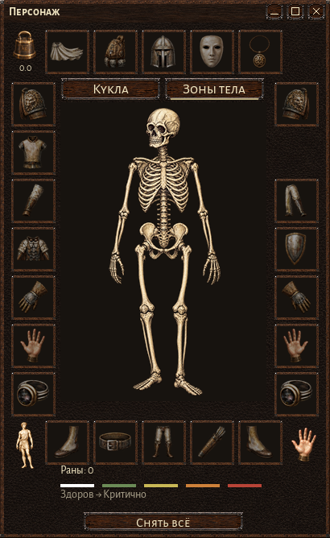
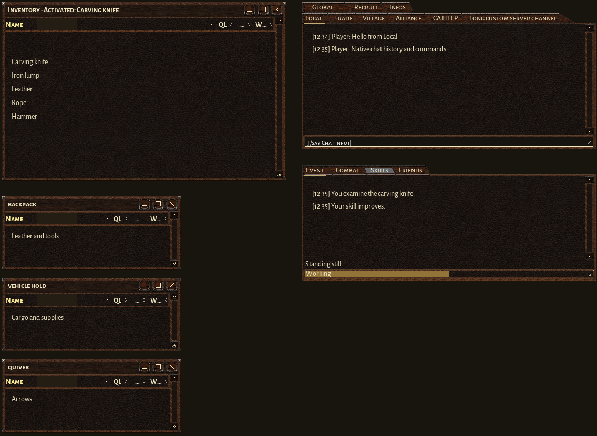
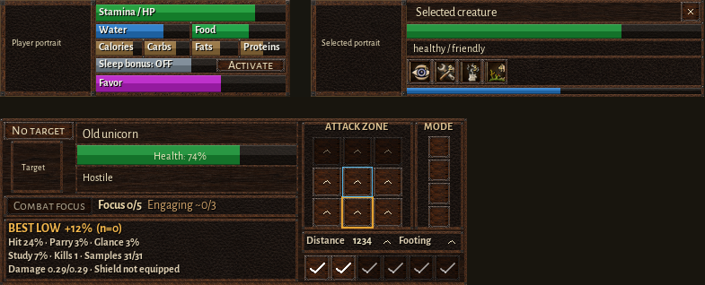

# Wurm High-res HUD



[](https://github.com/chamomilo/Wurm-HighRes-HUD/releases/latest)
[](LICENSE)

A unified client interface for **Wurm Unlimited**: Healthbar, Select bar,
Fighting HUD, Character, Inventory, containers, Chat and Events. Detailed
artwork, readable fonts and a consistent walnut-and-leather style accompany
Wurm's familiar item actions, chat history and window controls.

**Current release: 0.6.3.** Includes Chamomilo updater 1.4.1 and UI 0.4.11.
English, Brazilian Portuguese, German and Russian are supported.
No server mod is required.

[Download the latest ZIP](https://github.com/chamomilo/Wurm-HighRes-HUD/releases/latest)

## Character

The Character screen opens with your full-body 3D model. Drag to rotate it;
clicking or waiting changes its pose smoothly without zooming. Switch to
**Body zones** to inspect wounds and access their native actions.

- Healthy anatomy keeps its ivory color. Injuries progress from green through
  yellow and orange to red.
- Detailed, muted pictures identify empty equipment slots. Equipped items keep
  their full color and brightness.
- The weight corner shows carried weight and native limits on hover.
- The body corner provides the usual body and Manage actions; the hand corner
  selects hands as your active tool and shows whether they are selected.
- **Unequip all** performs Wurm's native Unequip all armor action.



## Inventory, containers, Chat and Events

The compact field beside **Name** filters loaded items as you type, including
matching nested items and their parent containers. Its text clears when the
window closes. The material column displays **m**, with its full meaning on
hover. Sorting runs once when opening a window or clicking a heading, so later
updates preserve your manual row order.

Dragging shows **Insert here** between rows and **Put inside** over a container.
The Inventory root remains first, with no insertion target above it. Backpacks,
quivers and server-opened containers use the same interface and native actions.

Chat and Events retain their commands, histories, editing and clipboard support.
Additional channel rows grow upward above the primary row. Right-click the
Skills tab to choose the smallest skill tick you want displayed.



## Healthbar, selection and combat

The Healthbar shows the player portrait, gauges, effects, fatigue, speed and
ride information, with Sleep bonus and Disembark controls. The Select bar adds
object portraits, status, action progress and paged quick actions. The compact
Fighting HUD combines target health, native attack zones, Combat focus,
special moves and optional learned target statistics.



These are rendered interface previews. Portrait areas use placeholders;
actual portraits and game data are supplied by the running client.

## Install or update

Requires **Wurm Unlimited** and
[Ago's Client Mod Launcher](https://github.com/ago1024/WurmClientModLauncher).
The mod targets Java 8, as used by the client launcher.

1. Download `highres-hud-0.6.3.zip` from the
   [latest release](https://github.com/chamomilo/Wurm-HighRes-HUD/releases/latest).
2. Close the client and extract the ZIP into your `WurmLauncher` directory,
   merging its `mods` folder with the existing one.
3. Confirm the following files are installed:

   ```text
   mods/highres-hud.properties
   mods/highres-hud/highres-hud-0.6.3.jar
   mods/highres-hud/highres-hud-resources-0.6.3.jar
   mods/highres-hud/portrait-profiles.bundled.properties
   ```

4. Disable any old standalone `highres-healthbar`, `highres-selectbar` or
   `highres-fighting-hud` mods: this package includes all three panels.
5. Start the game through Client Mod Launcher.

The ZIP contains these runtime files and `README.txt`. Existing window positions
and user preferences are retained. Keep the bundled portrait profiles in place;
they provide portrait framing when the shared loader hides JAR resources.

## Controls and settings

| Area | Controls |
| --- | --- |
| Character model | Drag to rotate; click changes pose; Model / Body zones switches views |
| Healthbar portrait | Click changes pose; wheel zooms; right-click opens display options |
| Select portrait | Drag rotates; wheel zooms; right-click opens native object actions |
| Select action shelf | Click the page indicator or use the wheel to change pages |
| Select Pin | Keeps selection visible; unpinned selection closes after the pointer leaves |
| Fighting portrait | Drag rotates; wheel zooms; double-click clears the target |
| Inventory | Type beside Name; click headings to sort; drag items to reorder or move them |

Open **Main menu > Mod updates** to select the shared language and check releases.
Language changes apply immediately to open panels. The updater selects the newest
compatible embedded updater among installed Chamomilo mods. Download opens the
release page; ZIP installation is manual.

Edit `mods/highres-hud.properties` while the game is closed to configure panels,
portrait resolution and combat data collection. Each panel has an
`enabledByDefault` setting. Optional custom portrait framing belongs in
`mods/highres-hud/portrait-profiles.properties`; the bundled reference remains
separate. Learned combat data is stored in `mods/highres-hud/knowledge` by default.
The HUD may issue quiet `/fatigue`, `/titles` and serialized Examine requests to
populate its displays; player Examine actions take priority.

## Build from source

Use JDK 8. Configure `wurmClientLibDir` in `local.properties`, using
`local.properties.example` as a starting point. The directory must contain
`client-patched.jar`, `common.jar`, `javassist.jar` and `modlauncher.jar`.
These proprietary libraries are not distributed with the project.

Set `CHAMOMILO_UPDATER_REFERENCE` to the canonical Chamomilo updater checkout,
then run:

```powershell
.\gradlew.bat clean check dist
```

Native interface checks also need the client's JavaFX JAR, supplied with
`-PwurmJavaFxJar=/path/to/jfxrt.jar`. The installable ZIP is written to
`build/distributions`. Builds check the updater, bundled UI, native input,
localization and the exact distribution contents.

## License and release history

[GNU General Public License v3](LICENSE).
The runtime JAR includes the license text and bundled font notices.
See [CHANGELOG.md](CHANGELOG.md) for release history.
