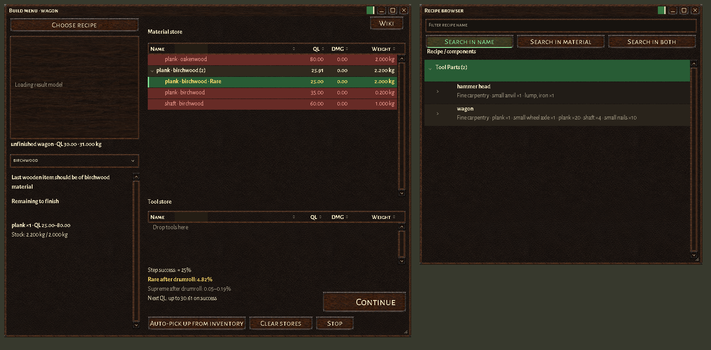

# High-res HUD for Wurm Unlimited


[](https://github.com/chamomilo/Wurm-HighRes-HUD/releases/latest)
[](LICENSE)

Readable windows, detailed portraits and a walnut-and-leather interface for
Wurm Unlimited. One client mod provides Inventory, containers, Character, Chat,
Events, Build, the recipe browser, Healthbar, Select bar and Fighting HUD.

**Version 0.8.7** includes **Chamomilo updater 1.5.0**, its shared Settings
editor and **Chamomilo UI 0.4.11**. Available in English, Brazilian Portuguese,
German and Russian. No server mod is required.

**[Download the installable ZIP](https://github.com/chamomilo/Wurm-HighRes-HUD/releases/latest)**

## Install or update

Requires Wurm Unlimited with
[Ago's Client Mod Launcher](https://github.com/ago1024/WurmClientModLauncher)
and the client's Java 8 runtime.

1. Close the game and download `highres-hud-0.8.7.zip`.
2. Extract it into your `WurmLauncher` directory, merging the `mods` folder.
3. Disable old standalone `highres-healthbar`, `highres-selectbar` and
   `highres-fighting-hud` mods; their panels are included here.
4. Start the game through Client Mod Launcher.

The installable ZIP contains exactly five files:

```text
README.txt
mods/highres-hud.properties
mods/highres-hud/highres-hud-0.8.7.jar
mods/highres-hud/highres-hud-resources-0.8.7.jar
mods/highres-hud/portrait-profiles.bundled.properties
```

Keep the bundled portrait profiles beside the JARs. Installation and updates
are manual. Guide images and development files are kept outside this ZIP.

## Settings, language and updates

Open **Main menu > Mod updates > High-res HUD > Settings**. Valid edits save
automatically; hover over an option for help.


| Setting | Effect |
| --- | --- |
| Font size | Changes window contents immediately; `0` follows the native preference. |
| Default opacity of inventory windows | Initial opacity for newly opened high-res windows, 10–100%. |
| Inventory, Events, Chat, Character, Build | Enables each window at the next client start. |
| HUD panel defaults | Initial panel visibility for a new HUD profile. |
| Portrait, animation and combat options | Adjusts portraits, gauge effects and combat observation storage. |

Startup-only changes show a restart notice. **Exit game** saves valid edits and
opens Wurm's normal quit confirmation. The shared Mod updates window also
selects the interface language and checks releases. **Download** opens the
release page for manual installation. See the [settings guide](docs/SETTINGS.md).

## Build and recipes

Open crafting with **B** (default binding), then click **Choose recipe** below
the title at the upper left. The console command `toggle creationlist` also
opens the browser.



Choose **Search in name**, **Search in material** or **Search in both**. The
selected mode is green; name search is the default and matches partial names.
Browse groups and recipe components with one click. Double-click a recipe,
including a nested component, to load it in Build and close the browser.

The bundled **Sklotopolis Novus catalogue has 2702 recipes**, captured on
2026-10-14 and prepared offline. Automatic catalogue comparison and refresh
are disabled. Catalogue updates are manual; unfinished-item requirements
continue to refresh from the live server.

1. Choose a recipe and its result material below the rotating model. Metal
   variants share one recipe; a metal selection is required and starting
   lumps or parts must match it. Wood selection is optional and protects the
   last remaining wooden component. **Any material** clears that restriction.
2. Drag items into **Material store** and **Tool store**, or use **Auto-pick up
   from inventory**. These stores reserve items without moving them. For a
   world tool, unfinished object or supported location such as a tile border,
   use its native **Add to crafting window** action.
3. Click a row to select the next material or tool; green marks the selection.
   Auto-pick retains alternative tools, so you can scroll and choose another.
   Drag rows to change their order. Double-click removes a reservation;
   right-click opens the item's native context menu.
4. Press **Build** or **Continue** when one usable step is ready. Full stores
   are unnecessary. The final selection is checked again before dispatch;
   remaining requirements update after server responses. Completing the
   unfinished target clears the Build screen.

Both stores use inventory-style filters, sortable Name/QL/DMG/Weight columns,
resizable headings and collapsible groups. Requirements show mass and QL.
Insufficient mass, missing required glowing heat and a conflicting final
material are red; hover explains the reason. Starting mass includes material
loss: for example, a 1 kg shaft needs 2 kg of log.

The **Wiki** button opens the recipe's Wurmpedia topic. Result previews use
native models and material palettes, including installed Material Colors masks.
Model availability depends on the client's resources.

Success, rarity and next QL refresh with the selected items and action results.
Initial success comes from the server; Continue uses the Keybinder Improve
calculation model adapted for crafting. Next QL is a successful-step upper
bound. Rare/Supreme values are conditional on a drumroll and success; eligible
rare stock highlights the affected chances in gold. Material rarity can also
transfer without a drumroll. Hover describes assumptions and account-status
ranges; hidden server modifiers can change estimates.
See [crafting details](docs/BUILD-MENU.md) and [rarity rules](docs/CRAFT-RARITY.md).

## Inventory, containers and opacity

Filter beside **Name** to find loaded items and matching nested contents.
The filter clears when the window closes. Click headings to sort.

During a drag, hold over a collapsed group for one second to expand it.
Release in another item window before one second to append at its root.
After one second, **Insert here** chooses a row position and **Put inside**
chooses a container. The chosen order survives server responses, including
multiple selected items. Native capacity and container restrictions apply.


The frameless **22 × 22 px opacity zone** sits immediately left of the title
buttons. Drag its marker horizontally for 10–100%; green fill and hover show
the value. Text and frame fade together while the control remains visible.
Each window keeps its own value; reopening uses the configured default.

## Chat and Events

Commands, history, editing and clipboard support remain native. Additional
channel rows grow above the primary row. Right-click **Skills** to choose the
smallest displayed skill tick.


Opacity and Minimize sit beside the channel tabs. Minimize hides the text area
and docks the strip at the lower screen edge, retaining tabs, opacity and
Restore. Click a tab or Restore to return to the previous size and position.

## Character and combat HUD

The Character window shows your full-body model. Hover explains rotation;
drag rotates and click changes pose. **Body zones** shows wounds from healthy
ivory through green, yellow, orange and red. Empty equipment slots use muted
artwork. Corner controls provide weight, body/Manage actions and hands as the
active tool. **Unequip all** uses Wurm's native action.


Healthbar shows gauges, effects, fatigue, speed and ride information, with
Sleep bonus and Disembark controls. Select bar adds target status, action
progress and paged quick actions. Fighting HUD provides attack zones, Combat
focus, special moves and optional learned combat statistics.


| Control | Action |
| --- | --- |
| Healthbar portrait | Click changes pose; wheel zooms; right-click opens display options. |
| Select portrait | Drag rotates; wheel zooms; right-click opens native target actions. |
| Select action shelf | Click its page indicator or use the wheel to change pages. |
| Select Pin | Keeps selection visible after the pointer leaves. |
| Fighting portrait | Drag rotates; wheel zooms; double-click clears the target. |

Images are rendered interface previews. The running client supplies actual
models, portraits, items and server data.

## Configuration and source

Settings overrides are stored in your user profile. You can also edit
`mods/highres-hud.properties` while the game is closed. Optional custom portrait
profiles belong in `mods/highres-hud/portrait-profiles.properties`; the bundled
reference remains separate. Combat observations default to
`mods/highres-hud/knowledge`.

See [build instructions](docs/BUILDING.md) for source builds. Distributed under
the [GNU General Public License v3](LICENSE); the runtime JAR includes
`META-INF/LICENSE.txt`, and bundled fonts retain their license notices.
